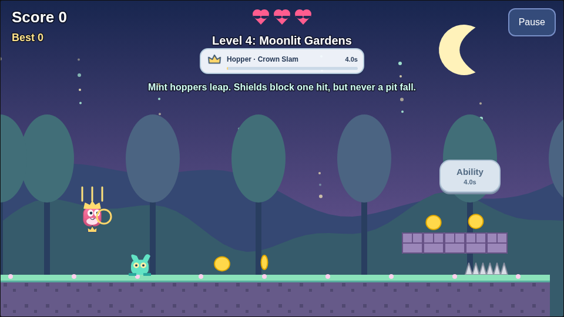
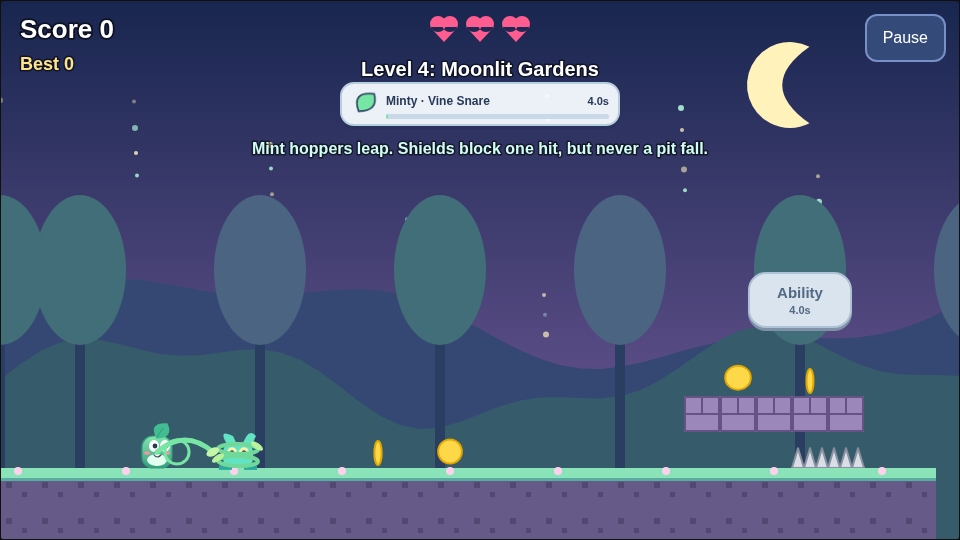
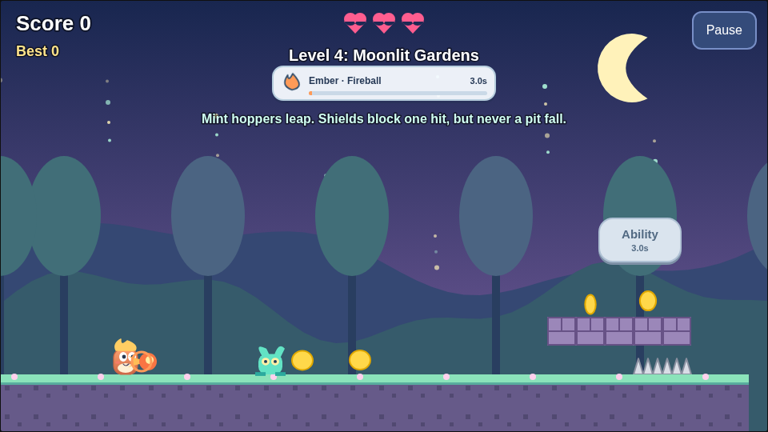
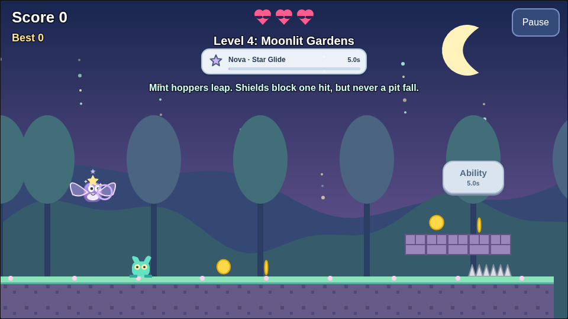
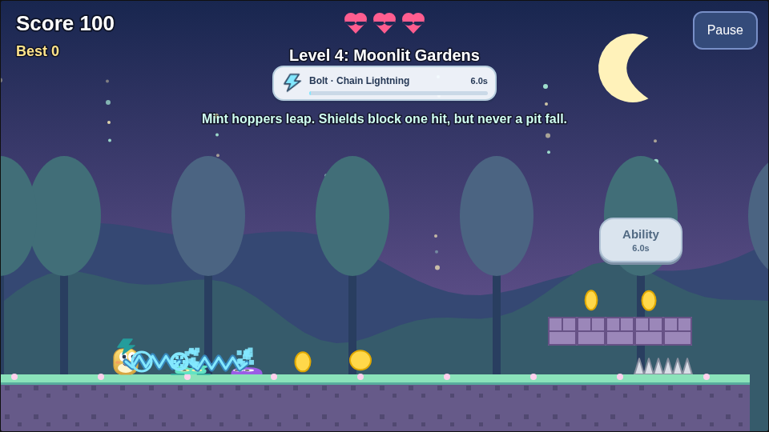
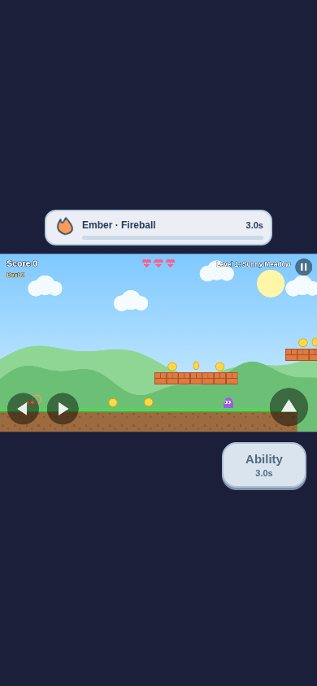
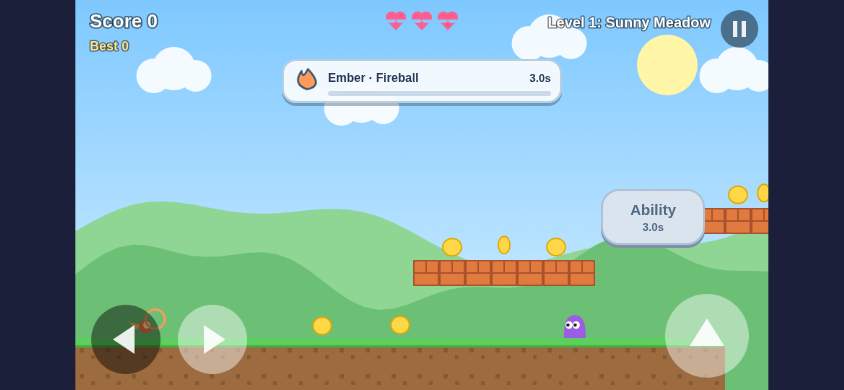

# Issue #5 verification

Local verification: October 26, 2026. Exact PR head, hosted run results and temporary
artifact links are recorded in the draft PR targeting `codex/character-select-redesign`.
This report is committed with the tested implementation. No merge, release, tag
or deployment is authorized or performed.

## Verified foundation

Started from character-selection head **`0c5d0ce3c34094eb57424ba2647c3e49f77c04af`**
([PR #8](https://github.com/guardian6b-lgtm/coin-hopper/pull/8)), after its 89 Node tests,
27 browser checks and hosted Windows installed/portable smoke checks passed.
Foundation CI: [gameplay/browser](https://github.com/guardian6b-lgtm/coin-hopper/actions/runs/40414820846),
[Windows](https://github.com/guardian6b-lgtm/coin-hopper/actions/runs/40414534997).
Technical verification is separate from human acceptance; the dependency stays draft.

## PASS / FAIL / NOT TESTED

| Check | Result | Evidence and scope |
| --- | --- | --- |
| Full local Node suite | PASS | **135 tests**, 0 failures/skips on Node 24.19.0. Original 89 retained plus 46 power cases. CI repeats the suite on Node 22 Linux and Windows. |
| All original maps/routes | PASS | Four full definitions and route fixtures match the verified parent. Each of five characters completes all four recorded routes without powers in Node and Chromium: totals 500/545/545/600, final 2190, three lives, no shield pickup. These are automated legal-input replays. |
| Shared gameplay rules | PASS | Existing movement/trajectory, hitbox, coin/stomp/flag scoring, enemy, shield, damage, menu and selection regressions still pass. No default physics/stat changes. |
| Power behavior | PASS | Per-character dispatch, allowed conditions, both facing directions, ranges, LOS, terrain, continuous projectile collision, single awards, nearest/max-two chain, root expiry/danger, glide landing/timeout, safe slam and pits. |
| Input and lifecycle | PASS | Repeat suppression, held E through cooldown, menu/blur input clearing, native button activation, pause/Settings/Controls freeze, shield hit, death/Game Over/retry/restart/level completion/transition/title cleanup including owned particles and sound nodes. |
| Chromium regression and abilities | PASS | **38 checks**, zero page errors. Existing 27 checks plus 11 power checks: actual E/native menus, five cast/resolution fixtures, pause and cleanup, HUD, responsive layout and three-finger CDP touch. |
| Responsive and simulated mobile | PASS | 390×844 portrait, 844×390 landscape, 320×240; button remains visible and separate from Jump's touch area. Movement+jump+Ability together; cancel clears held controls. Simulated touch only. |
| Power art and animation | PASS | Five active-effect browser screenshots and slam impact inspected. Gold slam, green vines, traveling orange fire, lavender glide and cyan lightning are distinct; HUD/button visible. Fixtures place actors and isolate pickups for clarity; they are not a human playthrough. |
| Effects-volume signal | PASS | Each cast's actual oscillator routes through effects gain. Chromium OfflineAudioContext renders each power: zero PCM energy at muted effects, nonzero at full volume. Distinct pitch/waveform configuration. This is not audible listening. |
| Linux Electron offline | PASS | Existing Electron 44.7.2 config builds an unpacked x64 app. Actual packaged app launches from app.asar, reloads offline, runs all five powers, freezes on pause, uses menus/movement/jump, shield, death/restart, and restores character/settings across process restart. |
| Windows x64 NSIS/portable | NOT TESTED locally | Linux cannot establish Windows native compatibility. Extended artifact-only Windows CI builds with `--publish never` and smoke-tests both actual installed and portable executables. Hosted results, tested SHA and reports are added to the PR after execution. |
| Windows F11 and resizing | NOT TESTED locally | Windows CI injects native F11 through Electron and resizes the real BrowserWindow. Local Linux run labels these NOT TESTED. Read the hosted report for the Windows result. |
| Physical phones/tablets | NOT TESTED | Real multi-touch ergonomics, browser chrome/rotation, device frame pacing and hardware controls require human interaction on devices. |
| Audible audio | NOT TESTED | Speaker/headphone loudness, timbre, clipping and simultaneous-effect clarity require listening. Signal checks do not establish these. |
| Human balance/art/accessibility acceptance | NOT TESTED | Play all four levels with each power; assess shortcuts, cast timing, root danger, shield/VFX readability, controls, formal contrast/screen readers. Balance proposals are in abilities.md. |

No confirmed unresolved software defect was observed in these local checks.
Human balance, physical devices and audible playback remain acceptance gates.
Recommended next action after green hosted checks: **human acceptance testing**;
keep this and the dependency PR draft until review is complete.

Full-definition SHA-256 hashes (`JSON.stringify(LEVELS[i])`), identical to the
verified parent. Collision/load functions and the character renderer were also
compared directly and are unchanged.

| Level | SHA-256 |
| --- | --- |
| Sunny Meadow | `2a98625b6ff56cbb64596eb57f15be3419c2c7de0e2a92182cee30e541bc3dcf` |
| Brick Hills | `2088933dba2eaf2392f8287391c824919877a1d0a35a5d23ce9f5649c55654a3` |
| Starry Night | `2dee0b8187afb49bb9c8078fc3e9dd23501ce1698c840aa206174aa5f73c3307` |
| Moonlit Gardens | `3b022ef3ad520b80a6fa3c51af9f11f1a0a01ad45e26e066568b1e7df347ccfe` |

## Reproduction and artifacts

```sh
node --test
# Optional isolated Playwright installation, not a game dependency:
npm install --prefix /tmp/coin-hopper-browser-tools --no-save --package-lock=false playwright@1.62.0
export NODE_PATH=/tmp/coin-hopper-browser-tools/node_modules
# Provide CHROMIUM_PATH or install Playwright's Chromium.
node scripts/verify-browser.cjs
# After building an unpacked desktop app with the existing configuration:
node scripts/verify-executable.cjs --executable /path/to/coin-hopper --label local --output /tmp/coin-hopper-executable
```

The browser script emits JSON reports and screenshots, including power fixtures.
Gameplay CI uploads `coin-hopper-browser-preview` and
`character-abilities-browser-evidence` (playable index.html, screenshots, reports).
The existing Windows verification workflow now covers this branch and all five
powers; it uploads `coin-hopper-windows-x64-verification` with temporary executables,
checksums and per-executable JSON/screenshots. Retention is seven days. It has read-only
repository permissions and never publishes. Product packaging settings, lockfile,
release workflow and published Pages game are unchanged.

## Browser screenshots

Captured from the real runtime using controlled actor fixtures in unchanged Moonlit
Gardens. Targets/pickups are isolated to make effects readable. Portraits/backgrounds
are existing artwork; screenshots do not claim physical-device or human playtesting.

| Power | Capture |
| --- | --- |
| Crown Slam descent |  |
| Crown Slam landing |  |
| Vine Snare |  |
| Fireball |  |
| Star Glide |  |
| Chain Lightning |  |




