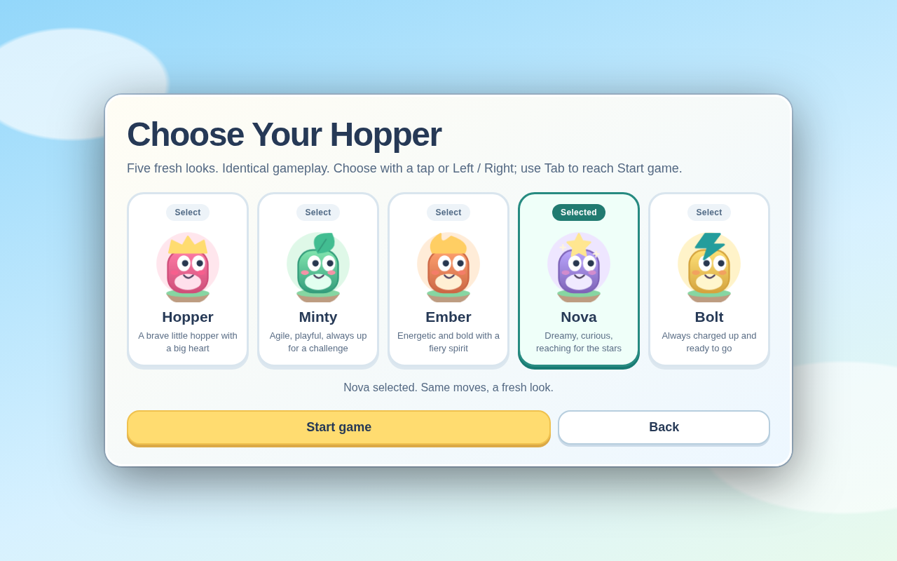
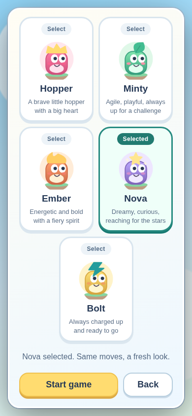
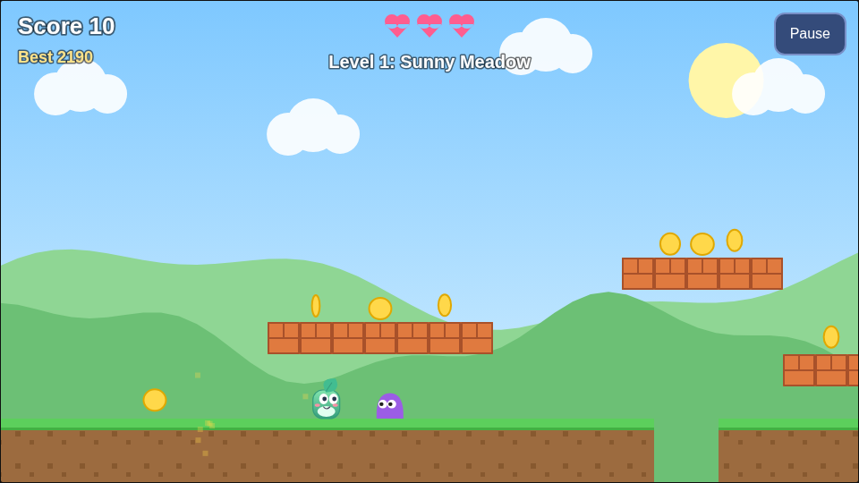
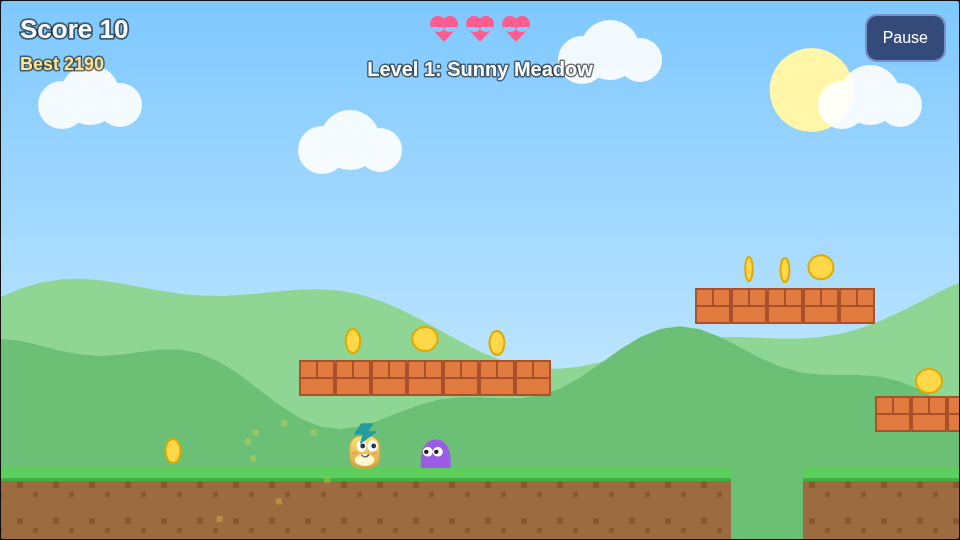
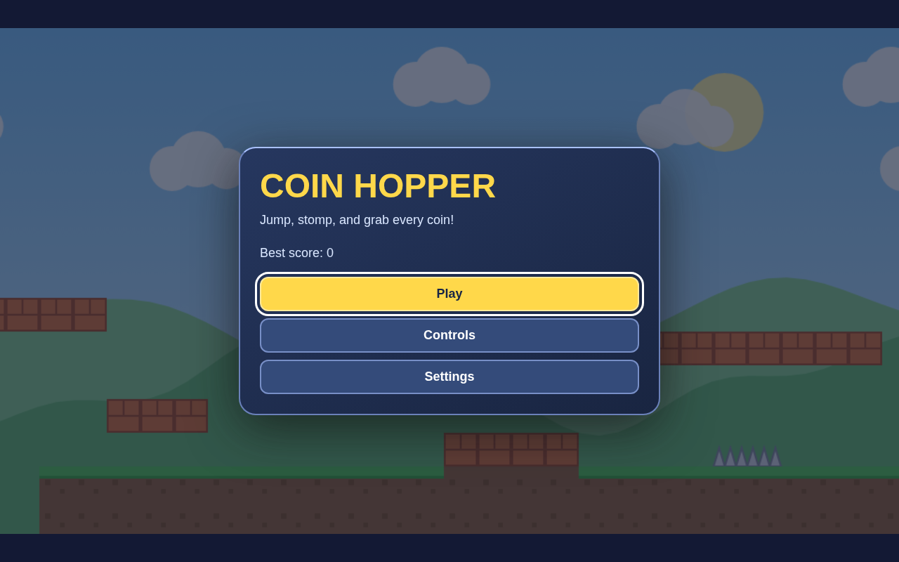
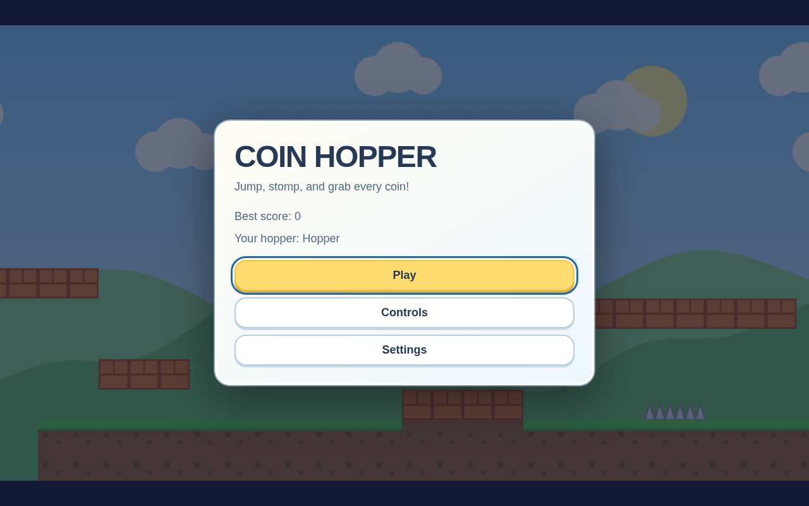

# Visual V1: Choose Your Hopper

This document records the isolated **Issue #4 foundation**. On the separate
`codex/character-abilities` branch, [Issue #5 adds explicitly activated powers](abilities.md).
Its current verification is in [the abilities report](abilities-verification.md);
the historical counts and cosmetic-only scope below describe the parent change.

Implements [Issue #4](https://github.com/guardian6b-lgtm/coin-hopper/issues/4) on
`codex/character-select-redesign`, based on verified `codex/moonlit-gardens`
`f2c87511898f9ccdbd01f8ebe8bae10380083ea0`. The draft PR targets that branch.
PR #3's human acceptance remains a separate prerequisite for eventual integration.
No PR is merged and no tag, release or deployment is part of this change.

## Cosmetic-only design

Every character uses the existing **26x32 collision body** and the same shared
movement, jump buffer/coyote time, collisions, lives, damage, shield, scoring and
level code. The roster contains names, flavor text and drawing palettes, with no
movement stats or abilities. A player stores only its cosmetic character ID.
Decorations extend the illustration without changing collision geometry.

| Character | Appearance | Flavor |
| --- | --- | --- |
| Hopper | Rounded pink hero, golden crown | A brave little hopper with a big heart |
| Minty | Mint/leaf green, one leafy sprout, white eyes and rosy smile | Agile, playful, always up for a challenge |
| Ember | Orange/coral body, warm yellow flame tuft | Energetic and bold with a fiery spirit |
| Nova | Violet/lavender, star crest and small static glints | Dreamy, curious, reaching for the stars |
| Bolt | Warm yellow body, teal zigzag crest | Always charged up and ready to go |

Flavor is personality, not a promise of speed, fire resistance, flight or other
abilities. Minty deliberately has one sprout, a rounded outlined player body,
white eyes and a smile; garden hoppers keep their two leaf ears, broad feet and
gold eyes. Human readability review at gameplay scale remains an acceptance item.

The issue's written art bible was read in full. Its referenced concept image is
not attached to the task or issue. The implementation follows the written bright,
rounded cartoon direction without claiming a pixel comparison to that image.
Portraits use grassy pedestals and the same `drawCharacter` Canvas2D helper as
gameplay. No flattened concept art, sprite atlas, network asset or runtime package
is added. Portraits and their decorative glints are static; the existing game
squash/recovery animation is preserved.

The title and picker share a light rounded panel/button treatment. Picker cards
have a visible outline, explicit Selected label, pressed state and separate focus
outline. Other menu flows and level/world artwork remain intact; this is not the
world-art, full HUD/menu, music or animation overhaul planned for later phases.

## Flow, keyboard and persistence

1. Title → **Play** → **Choose Your Hopper**. This does not start or reset a run.
2. Tap/click a portrait or use Left/Right on a focused character. Home/End choose
   first/last. Enter/Space on a portrait selects it without starting gameplay.
3. Tab/Shift+Tab stays inside the menu and reaches **Start game** and **Back**.
   Start game confirms, saves the choice and starts a fresh run on Sunny Meadow.
4. Back/Escape cancels the previewed choice and restores focus to title Play.
   The saved choice is changed only by Start game. Gameplay receives focus with
   held inputs cleared, preventing selection from queuing a jump.

The last confirmed ID is stored as a plain allowlisted string under
`coinhopper_character_v1`. Missing, malformed or unknown IDs fall back to Hopper.
Blocked reads/writes are caught: the chosen look works in the current session,
and a later session without storage starts safely with Hopper. Best-score and
audio keys are untouched. Storage is scoped to the browser origin or Electron
profile, as with the existing settings.

Appearance survives death, pause/resume, restart, all level transitions, completion
and Game Over. **Try again** keeps the same character; return to title and choose
Play to change it for another run. Controls and Settings do not expose character
changes during a running game. Phone pickers use a scrolling panel when needed;
short viewports get compact cards and every selectable control remains at least
44 CSS pixels in each dimension.

## Verification and evidence

```sh
node --test
# Optional: requires Playwright; the cloud environment supplies it and Chromium.
node scripts/verify-browser.cjs
```

The dependency-free Node suite passes **89 tests** locally on Node 24.19.0: the
existing 64 regressions adapted to the deliberate Play → Start game flow, plus
25 character cases. All five variants complete all four legal recorded routes
and a continuous run with identical outcomes: level totals 500, 545, 545, 600;
final score 2190, three lives and no shield pickup. These results match the
verified base. Physical trajectories are compared frame by frame between skins;
coin/stomp/shield/spike/pit behavior and appearance lifecycle are covered per skin.

The expanded real Chromium suite passes **27 checks**, including 20 character/level
routes using real keyboard handlers and Canvas2D with a fixed 60 Hz scheduler.
Live checks cover picker pointer/keyboard navigation, cancel/focus, real reload
persistence, blocked storage, shield/pit/restart behavior, responsive layout,
44px touch targets, and CDP mobile selection/multi-touch/cancellation/rotation.
The simulated routes are not a human playthrough. No page JavaScript errors occur.

| Check | Local result | Scope / remaining gate |
| --- | --- | --- |
| Node suite | PASS | 89 tests, zero failures/skips. All four complete level definitions and movement/simulation code also compared directly with the verified base. |
| Browser artwork/navigation | PASS | Five distinct portraits, actual player variants and explicit selected/focus state. Desktop/phone screenshots inspected. |
| Responsive and simulated touch | PASS | 390x844, 844x390 and 320x240 picker controls reachable; native mouse/keyboard and CDP touch tested. |
| Character lifecycle and parity | PASS | Every skin survives death/restart/transitions/Game Over and shares physical trajectories, collision outcomes, scoring, and all four completion routes. |
| Linux Electron offline package | PASS | Unpacked build, real offline packaged launch, selection, respawn/restart, shield, saved character/settings across full process restart. |
| Windows build/executable checks | NOT TESTED locally | The existing artifact-only Windows workflow is enabled for this feature branch and extended for selection/persistence. Use its PR check and artifact reports for hosted Windows results; do not infer them from Linux. |
| Physical phones/tablets | NOT TESTED | Touch comfort, real rotation/browser chrome and device rendering need human/hardware acceptance. |
| Human accessibility/art acceptance | NOT TESTED | Real screen readers, formal color-contrast assessment, recognition of Minty versus enemies, and matching the unavailable concept image require human review. |
| Audible/device and human gameplay | NOT TESTED | No speaker/headphone listening or human balancing/play session is claimed. Existing audio/gameplay regressions remain covered separately. |

The Gameplay checks workflow runs Node 22 on Linux and Windows. Its PR browser job
uploads **character-select-browser-evidence**, with screenshots, JSON results and
the self-contained playable page. The Windows workflow builds NSIS/portable x64
with `--publish never`, smoke-tests selection and saved character in the actual
executables, and retains temporary artifacts for seven days. Product dependencies,
lockfile, Electron permissions and the publishing/release workflow are unchanged.
Platform-specific hosted results and commit/artifact links are recorded in the PR.

### Screenshots

These are actual browser captures, not the concept reference or a new sprite atlas.
The phone image shows the scrolled picker; the heading is available above it.









The PR also includes before/after title captures to show the limited menu-style
change. No world-background replacement is included.

| Verified base title | Visual V1 title |
| --- | --- |
|  |  |
