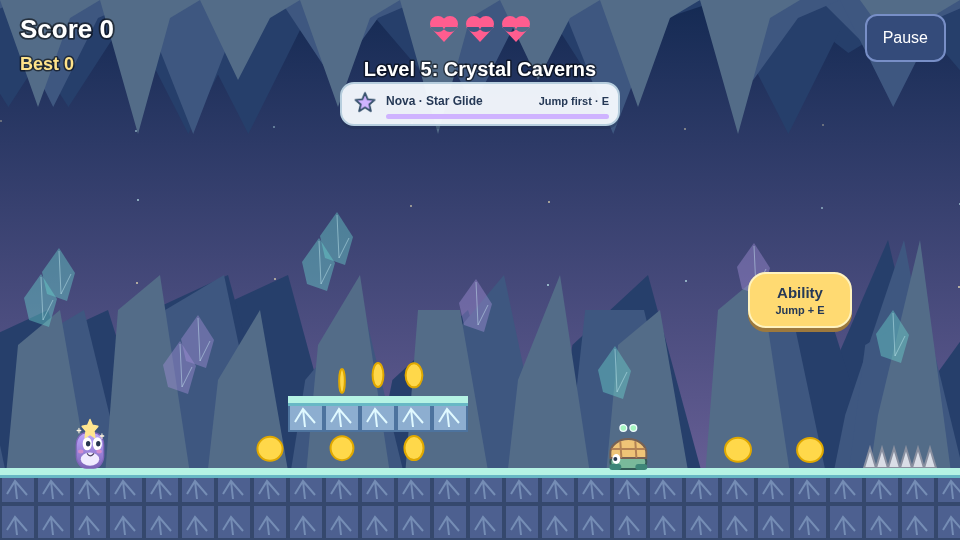
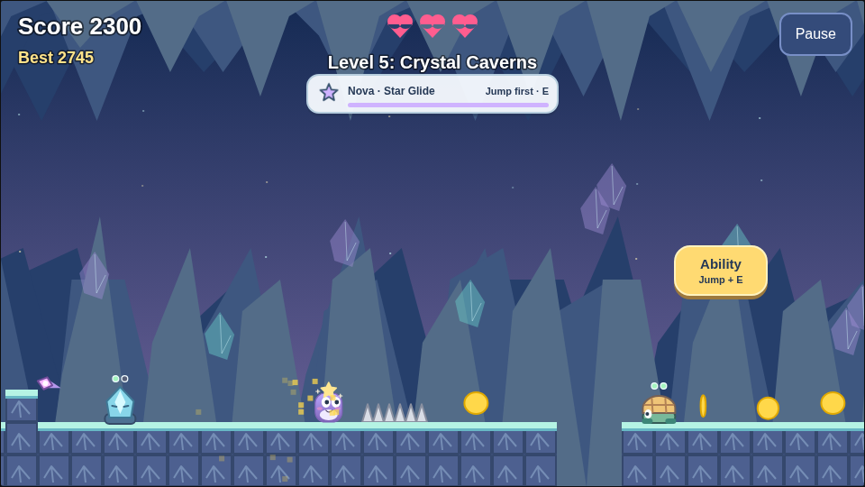
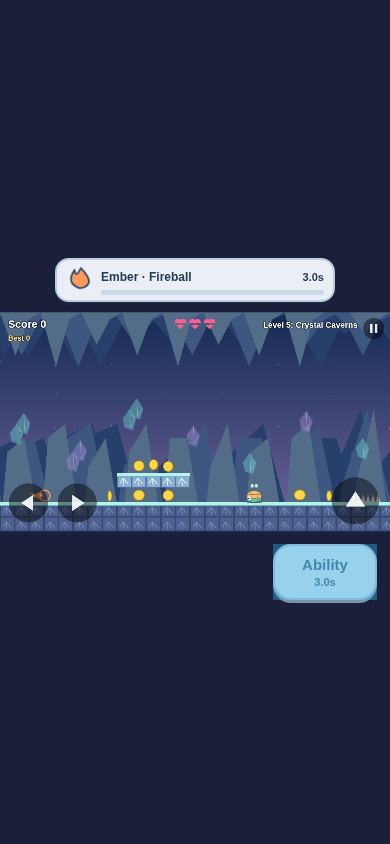

# Stage B — Crystal Caverns (Issue #11)

Implements [Issue #11](https://github.com/guardian6b-lgtm/coin-hopper/issues/11) on
`codex/crystal-caverns`, stacked from Stage A / draft PR #17 at verified
**`ddcdba9bfaee1a3d9f406883928237d140d1e6f0`**. That head passed 196 Node tests,
54 Chromium groups and Windows installed/portable smoke before this branch began.
Exact Stage B commit, hosted results and temporary artifacts are recorded in its
draft PR targeting `codex/enemy-balance`. No merge, tag, deployment or release.

## Design and preservation

Level 5 is a new 148-column cave map, not a recolored copy of another layout. A
blue/lavender cavern, layered rock silhouettes, cyan facets and sparse sparkles
distinguish it. Collision surfaces remain full grid rectangles; decorative crystals
are background only. System `prefers-reduced-motion` makes the new sparkles static.
This is the first cave environment pass; matching the approved graphical reference
across the whole game is separately scoped to Issue #13.

The safe opening gives space to learn Shellback armor. The first Sentinel follows
a low cover ledge; later sections combine armored patrols, visible ranged attacks,
small spike groups and two/three-tile pits. Cover blocks acquisition and shots.
Three bonus platform groups at columns 8–12, 39–43 and 135–140 offer raised coins;
the final group is three tiles high and is reachable with the original held jump.
One optional shield sits on the middle bonus platform, away from the base route.
The final strip leads to a clear supported flag.

- Three **2-HP Shellbacks** and three **2-HP Sentinels**, 37 coins, one shield,
  four pits and seven spike tiles. New markers `b` / `s` create bottom-aligned
  actors using the existing factory; original `e` / `h` semantics are untouched.
- No new enemy types, abilities, HP changes, physics, character stats or score
  rules. All original four complete level definitions and route fixtures remain
  unchanged; shared simulation, terrain collision and character drawing are intact.
- Restart removes only this level's earned points and restores its actors/pickups.
  Death retains earned damage/coins and clears transient combat as Stage A defines.
  Completion clears protection/powers, then offers Finish for the temporary
  five-level game. No unimplemented Level 6 placeholder is entered.
- No checkpoint is added. The base route is about 20 seconds; a checkpoint can be
  reconsidered with explicit score/respawn semantics in Stage F / Issue #16.

## Recorded legal-input routes

`tests/fixtures/routes.cjs` is the original, unchanged four-level recording.
`tests/fixtures/crystal-caverns.cjs` adds two keyboard recordings;
`campaign-routes.cjs` appends the expansion to the original routes. Input is replayed
through the actual handlers at 60 Hz without world/player/enemy edits, invulnerability
changes or collision shortcuts during a route.

| Route | Frames / score | Outcome |
| --- | --- | --- |
| Base | 1187 frames; 555 points | Every hero finishes with three lives, no power use and no shield pickup; 25 coins, no defeat score, original 305-point flag award |
| Optional raised coins | 1204 frames; 600 points | Every hero reaches all nine elevated coins across all three groups and the optional shield. Three lives; shield is never consumed to mask damage; no powers |
| Continuous five-level run | 2745 points | Each hero retains the original checkpoints 500/1045/1590/2190, then adds 555; three lives and no shields/powers throughout |

No-power completion proves reachability, not human difficulty or touch comfort.
The 0.8s Sentinel warning and locked aim remain provisional playtest values. Human
acceptance should assess cover readability, the first cracked armor feedback, the
three-tile bonus jump, spike/pit spacing and pressure in the final combinations.

## PASS / FAIL / NOT TESTED

Local verification October 26, 2026 (America/New_York). Hosted outcomes and tested
SHA are linked in the draft PR after execution.

| Check | Result | Scope |
| --- | --- | --- |
| Full Node suite | PASS | **211 tests**, no failures/skips on Node 24.19.0, including the 196-test foundation and 15 campaign/Level 5 cases. Old final-level menu assertions now correctly continue past Level 4; old maps and route outcomes are preserved. |
| All five heroes × five levels | PASS | Legal-input, no-damage/no-power/no-shield continuous runs, original checkpoint scores unchanged. |
| Raised routes and shield optionality | PASS | Every raised coin group reachable for all heroes; base path collects no shield. Optional route's protection never absorbs a hidden hit. |
| Full Chromium suite | PASS | **64 groups**, zero page errors: original 54, five new level/hero routes, five cave/bonus/reduced-motion/lifecycle/mobile groups. |
| Real Canvas2D and simulated mobile | PASS | Intro and actual no-power route captures; 390×844, 844×390, 320×240. Native pointer/keyboard plus mobile Ability; existing three-finger regression retained. Cave reduced-motion pixels remain static. |
| Linux Electron offline | PASS | Existing unpacked x64 config and real offline packaged app; every hero replays the new route in the actual renderer using a suspended RAF/fixed-step test scheduler. Native menus/controls, power/enemy tests and saved settings/character continue separately in real time. |
| Windows NSIS/portable and Node 22 CI | NOT TESTED locally | Hosted artifact-only verification enabled for this branch. Both actual executable smoke tests include all five new-level no-power routes, native F11/resize, offline and process-restart persistence. Final outcomes are in the PR. |
| Physical devices, audible audio, human difficulty/art/accessibility | NOT TESTED | Human/device acceptance still required; no inference from simulations. Original music is not implemented at this stage. |

No confirmed unresolved software defect from the completed checks. Stage C starts
only after this stage's technical compatibility gates pass. Nightwing, Skyline
Summit and Stone Guardian remain outside this PR; the reconciled README preserves
their approved plans and the separate PR #7 stays untouched.

Browser harness correction: the multi-touch cancellation check observes delivery
of the actual touchcancel event before checking controls. A CDP compositor
acknowledgement alone could race that handler under load. Twenty focused runs
cleared inputs, and the synchronized full suite passes; no product input or physics
change is made for this test correction.

## Preview and reproduction

```sh
node --test
# With isolated Playwright 1.62 and Chromium installed:
node scripts/verify-browser.cjs
node scripts/verify-executable.cjs --executable /path/to/coin-hopper --label local --output /tmp/cave-smoke
```

Download **crystal-caverns-browser-evidence** for the self-contained five-level
`index.html`, screenshots and JSON reports. `enemy-arena.html` remains a separate
test fixture, not a campaign level. Windows installer/portable executables and
checksums are temporary **coin-hopper-windows-x64-verification** artifacts. Seven-day
retention, no publishing. Product Electron package/lockfile/main.js and release
workflow are unchanged.






