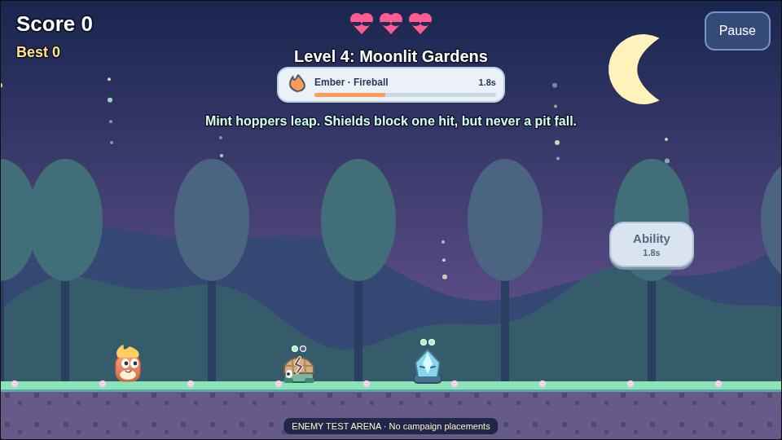
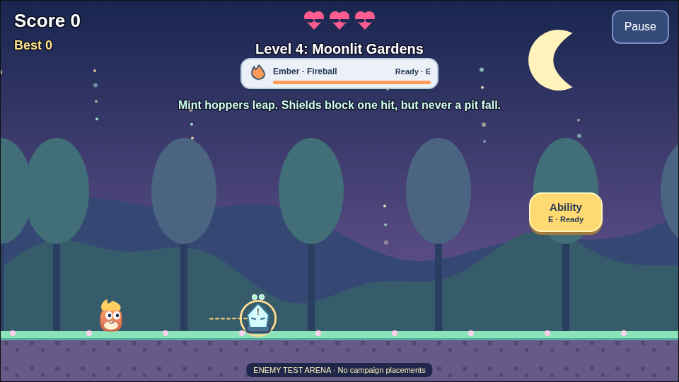
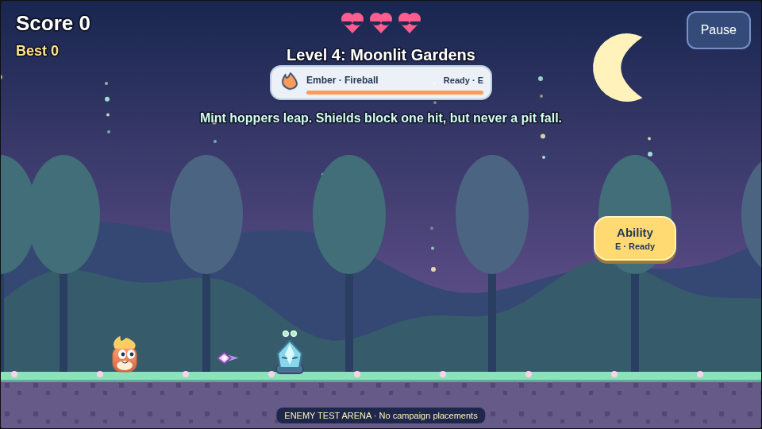
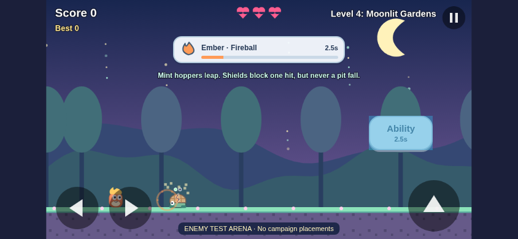
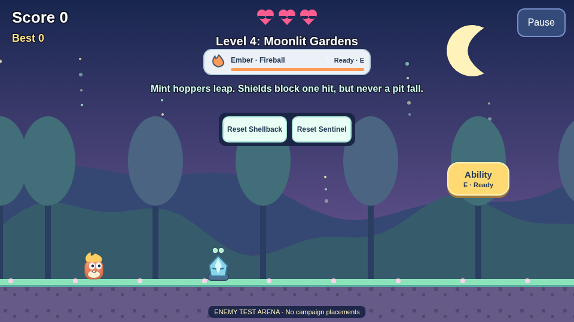

# Enemy Phase 1 verification

Verified locally October 26, 2026 (America/New_York). Exact feature head, hosted CI
results and seven-day artifact links are recorded in the draft PR targeting
`codex/character-abilities`. No merge, release, deployment or tag is performed.

Foundation: [PR #9](https://github.com/guardian6b-lgtm/coin-hopper/pull/9), verified head
`9736d908738692411eff1ea27c58d858fb224a7e`. Its [Node 22 Linux/Windows and 38-browser-check
run](https://github.com/guardian6b-lgtm/coin-hopper/actions/runs/40422729550) passed;
its identical application build at `b8841c1039a86bc0fbc1e5d8ad960265c539d039` passed
[Windows installer/portable checks](https://github.com/guardian6b-lgtm/coin-hopper/actions/runs/40421190823).
All **135 baseline tests passed again before source changes**. Issue #6 including
its dependency-checkpoint comment and PR #9's final evidence were read first.

| Check | Result | Scope / evidence |
| --- | --- | --- |
| Full local Node suite | PASS | **196 tests**, no failures/skips on Node 24.19.0; all 135 baseline tests retained plus 61 enemy tests. Hosted CI repeats on Node 22 Linux and Windows. |
| HP, damage and scoring | PASS | Two HP, no first-hit score, 0.3s guard, flash expiry, original bounce, one defeat award and 0.4s cleanup. Simultaneous projectile+stomp cannot double-hit; no duplicate chain or farming. Legacy one-hit types pass all regressions. |
| Every hero / both enemy types | PASS | Ten fights starting on the floor using only legal movement/jump input against default patrol/attack AI, ten isolated two-stomp collision cases, plus attacking powers, snare/expiry and active-glide stomp checks. Real browser/Electron fixtures exercise each pair as well. |
| Campaign maps and routes | PASS | All four complete level definitions match the verified parent. No new enemy placements/markers. Route fixtures, terrain collision and character renderer match parent; every hero completes all four legal-input no-power routes, final score 2190 / three lives / no shield pickup. |
| Sentinel attack safety | PASS | Ready/wind-up/recovery ticks, locked aim, line of sight, range, offscreen cancel, finite shot lifetime/count, continuous terrain/player collision including high-speed/tie cases, owner-defeat cleanup. |
| Shield and lifecycle | PASS | Shield absorbs one shot, recovery consumes later colliding shots, damage/last-life handling, no duplicate survivors. Pause/Settings/Controls/blur/restart-cancel freeze; death/restart/completion/title/new-run clear transient state with documented HP policy. |
| Chromium regression/new mechanics | PASS | **54 checks**, no page errors: existing 38 retained plus 16 enemy/arena groups. Native E/Space, all ten pairs, actual Canvas2D art, wind-up/shot, native pause/settings/restart, terrain sweep, shield/death, simulated touch and review-arena offline execution. |
| Desktop/mobile screenshots | PASS | Intact/cracked armor, Sentinel wind-up/projectile/wall impact, mobile Ability and review-arena captures inspected. Controlled fixture scenes, not human playthroughs or campaign placements. |
| Linux Electron offline build and launch | PASS | Existing Electron 44.7.2 config builds unpacked x64. Actual app.asar app reloads offline, runs all powers and ten hero/enemy combinations, Sentinel/shield/terrain/pause/death/restart checks, and restores character/settings across process restart. |
| Effects-volume routing | PASS | New hit/shot tones route through effects bus; muted gain and stop-on-pause covered in Node. Existing five power PCM/audio checks remain covered. No audible listening claimed. |
| Windows x64 NSIS/portable | NOT TESTED locally | Artifact-only hosted workflow enabled for `codex/enemy-balance`, builds with --publish never and tests both actual executables including new mechanics. Final hosted outcome and tested SHA are recorded in the PR. |
| Native F11/resize | NOT TESTED locally | Linux headless smoke labels these NOT TESTED. Hosted Windows smoke injects native F11 and changes actual BrowserWindow size; read PR evidence for its result. |
| Physical phones/tablets | NOT TESTED | Hardware multi-touch ergonomics, browser chrome/rotation, small-screen readability and frame pacing require real devices. |
| Audible SFX / human accessibility and art | NOT TESTED | Speakers/headphones, formal contrast/screen readers and subjective appearance/readability require human acceptance. |
| Human balance and future placements | NOT TESTED | Use the isolated arena to review 2-hit fairness, wind-up/aim, shield/power interactions. Campaign placements, Nightwing, Level 5/6 and boss are not implemented. |

No confirmed unresolved local software defect. After green hosted checks, the next
step is human acceptance of the isolated mechanics; keep this and dependencies
draft. Passing automation does not establish balanced future levels or device/audio
acceptance. Proposed tuning and policies are in [the guide](enemies-phase-one.md).

## Reproduce

```sh
node --test
# With isolated Playwright 1.62 and Chromium installed (see docs/abilities-verification.md):
node scripts/verify-browser.cjs
# After building the existing unpacked Electron app:
node scripts/verify-executable.cjs --executable /path/to/coin-hopper --label local --output /tmp/enemy-smoke
```

The browser script emits `results.json` (54 groups), `enemy-results.json` (16 new
groups), captures and a self-contained `enemy-arena.html`. CI retains these plus
the normal playable `index.html` as **enemy-phase-one-browser-evidence**. Windows
verification retains NSIS/portable executables, SHA256SUMS, per-executable JSON,
screenshots and TAP evidence as **coin-hopper-windows-x64-verification** for seven
days. Its product page is checked against the committed source before packaging.
Product package/configuration/lockfile/main.js and release workflow are unchanged.

## Controlled-fixture screenshots

These captures use a temporary plain floor with existing Moonlit Gardens scenery.
The Level 4 HUD/background does **not** indicate a changed campaign map. The test
arena badge and the separate artifact-only reset controls are not shipped UI.

| Intact armor | First hit: crack, one HP, zero points |
| --- | --- |
|  |  |

| Telegraph | Shot in flight |
| --- | --- |
|  |  |




