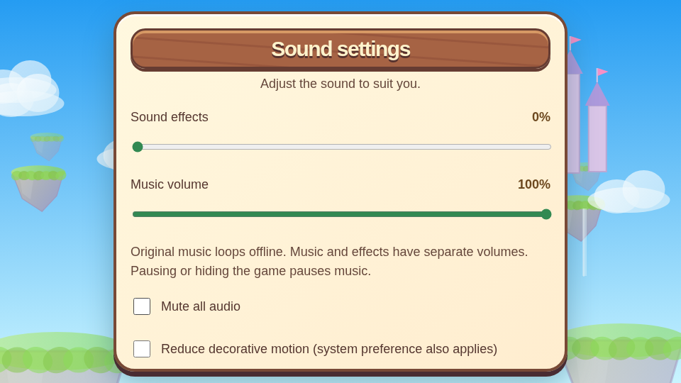

# Stage E — original music and audio controls

Implements [Issue #15](https://github.com/guardian6b-lgtm/coin-hopper/issues/15),
stacked on verified [Stage D / draft #20](https://github.com/guardian6b-lgtm/coin-hopper/pull/20)
at `b1f306b5e36ea75bad48239e552447767a7675a2`. Branch `codex/music-audio`;
exact final SHA and hosted artifacts are recorded in its draft PR. No merge,
deployment, tag or public release.

## Score provenance and implementation

The score is newly authored in this change as explicit note/chord motifs and
arrangements in `MUSIC` / `composeMusic` in `index.html`. Source history and literal
note tables provide inspectable provenance: no downloaded music, borrowed game
melody, sample recording, music library or external audio asset is used. Sine
voices, a quiet second harmonic, soft note envelopes, bass pulses and three-note
chords produce the score locally. The existing character-ability oscillators and
their distinct identities remain; every effect still passes through effects volume.

Each theme is eight four-beat bars, synthesized deterministically at 22050 Hz into
one mono buffer, then cached. `AudioBufferSourceNode.loop` supplies continuous
playback without timer-based rescheduling; first/last source samples are zero.
Musical rests are part of the score. No network, audio file installation, runtime
package dependency or Electron permission change. All eight cached buffers total
about 12.3 MB; the bundled composition code adds only a few KB to the existing page.

| Theme | BPM | Root / mode | Source loop |
| --- | ---: | --- | ---: |
| Title / character selection | 108 | C major | 17.78 s |
| Sunny Meadow | 116 | C major | 16.55 s |
| Brick Hills | 120 | D major | 16.00 s |
| Starry Night | 100 | E major | 19.20 s |
| Moonlit Gardens | 104 | D minor | 18.46 s |
| Crystal Caverns | 92 | A minor | 20.87 s |
| Skyline Summit | 124 | F major | 15.48 s |
| Stone Guardian arena | 132 | D minor | 14.55 s |

The Guardian theme begins in the arena while the required boss is alive. Defeat
returns to the Summit arrangement. Completion/Game Over/victory stops the loop so
existing fanfares can play. Title/select share one continuing loop. Fresh runs and
restart begin at the loop start; ordinary death keeps the current arrangement.

For inspectable listening previews, generate original source WAVs:

```sh
node scripts/export-music.cjs /tmp/coin-hopper-music
```

The browser artifact includes all eight mono 16-bit WAV loops, a checksum manifest
and provenance note in `music-preview/`. They are the source score before playback
volume/master processing, not microphone recordings or public releases. Runtime
does not load those files.

## Controls, lifecycle and mixing

- Music starts after a real user interaction. Page load/drawing creates no
  AudioContext and attempts no autoplay. Rejected resume or unavailable audio
  hardware safely leaves gameplay usable without sound.
- Settings has independent **Music volume**, **Sound effects** and **Mute all
  audio**. Existing `coinhopper_settings` numeric preferences are unchanged;
  global mute uses separate `coinhopper_audio_v1`. Character, best score and
  reduced-motion preferences are preserved. Missing/blocked storage is safe.
- Pause, paused Settings/Controls, restart confirmation, blur or hidden document
  stops the music source and retains its exact loop position. The master is muted
  and delayed effects cannot play during pause. Focus/visibility never resumes a
  paused game automatically; Resume restores the loop from its retained offset.
- Title Settings/Controls allow volume preview. Zero music volume/global mute
  stops the loop; unmute resumes its position. Effects zero does not mute music.
- Separate effects/music gains feed a shared dynamics compressor (−12 dB
  threshold, 8 dB knee, ratio 20, 1 ms attack, 120 ms release), followed by a 0.7
  master for headroom. Score samples are softly bounded. Existing ability/enemy
  sounds pass through the same protected output; no sound is the only cue for
  power readiness, enemy warnings, damage or boss phases.

## PASS / FAIL / NOT TESTED

Local verification October 26, 2026 (America/New_York). Exact-head hosted results
and temporary artifact links are in the draft PR.

| Check | Result | Evidence / scope |
| --- | --- | --- |
| Full Node suite | PASS locally | **268 tests**, previous 251 retained; eight deterministic scores, routing, autoplay/rejected resume, pause/offset, mute, blur/visibility, restart and silent fallback |
| Original gameplay | PASS | All six definitions, balance tables and authoritative simulation functions remain hash-locked to Stage C; no movement/scoring/map changes |
| Full Chromium | PASS locally | **88 groups** include previous 84 and four real music/UI/signal groups; all 30 no-power/no-shield routes retain 3510 points / three lives |
| Real music signal / loops | PASS locally | Eight distinct OfflineAudioContext arrangements, two loops each, finite nonzero signal, zero measured loop seam discontinuity in this renderer |
| Independent volumes and mute | PASS locally | Native controls, reload persistence and real output measurements: music-only/effects-only nonzero rendered signal; both-zero and global mute exactly zero RMS |
| Overlap / clipping | PASS for tested stress | Five actual power casts, player/enemy sounds, sixteen extra tones and music: maximum normalized peak **0.491**, below clipping at 1. Effects-only peak 0.480; music-only peak 0.134 |
| Native pause / lifecycle | PASS locally | Keyboard P, paused Settings, retained offset, Resume, injected blur/focus; hidden-document behavior also covered in Node |
| Source WAV previews | PASS | Eight valid 22050 Hz / mono / 16-bit WAV files independently parsed; manifest includes sizes/durations/checksums |
| Actual offline Linux Electron | PASS | Full executable smoke adds native settings, loops, real signal/mixing and pause checks |
| Windows Node 22 / NSIS / portable | See PR | Same actual offline renderer audio checks, actual native minimize/restore without auto-resume, plus previous F11/resize/saved preferences/powers/enemies/routes |
| Audible quality, preferred loudness, loop feel, speaker/headphone output | NOT TESTED | Signal measurements do not establish human sound quality or physical output |
| Real phones, hardware mute/Bluetooth/background behavior, human accessibility | NOT TESTED | Browser touch and synthetic focus events are automation; actual human/device acceptance remains open |

The initial pause test caught an arrangement change that reset its loop position;
pause/paused submenus now retain the prior theme and offset. Real browser checks
also account for AudioParam float precision and wait for its render-quantum update
rather than assuming immediate exact decimal values. No confirmed unresolved defect
remains in completed checks. Wider audio-device/CPU testing and human mix/melody
approval remain necessary; no audible PASS is claimed.

Next is Stage F / Issue #16 progression, only after this stage's technical gates
pass. The reconciled roadmap remains in README; PR #7 remains separate and unmerged.


