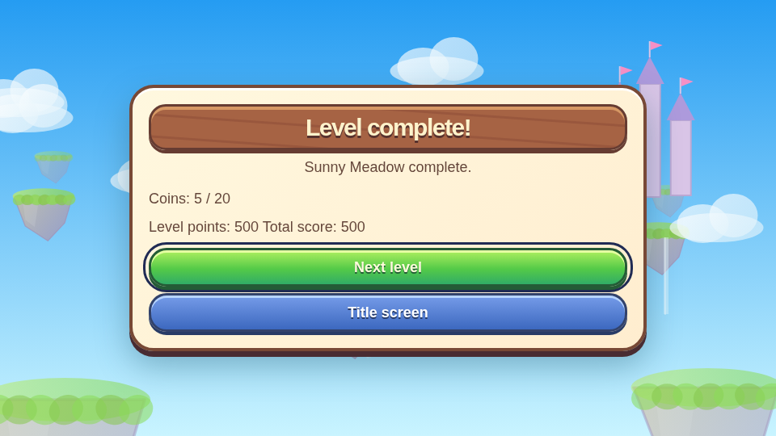
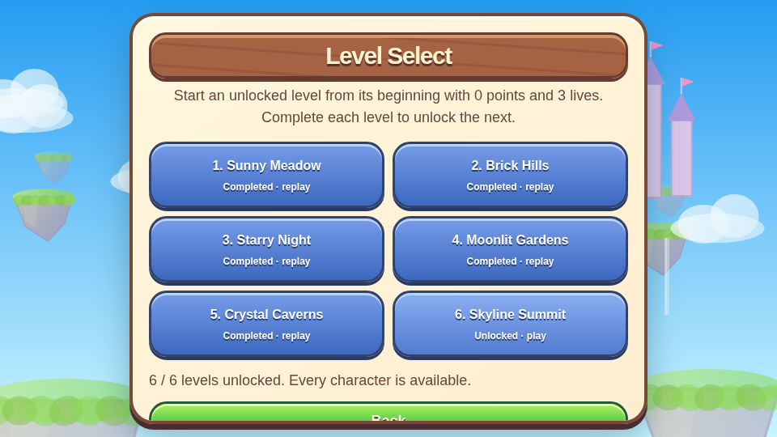
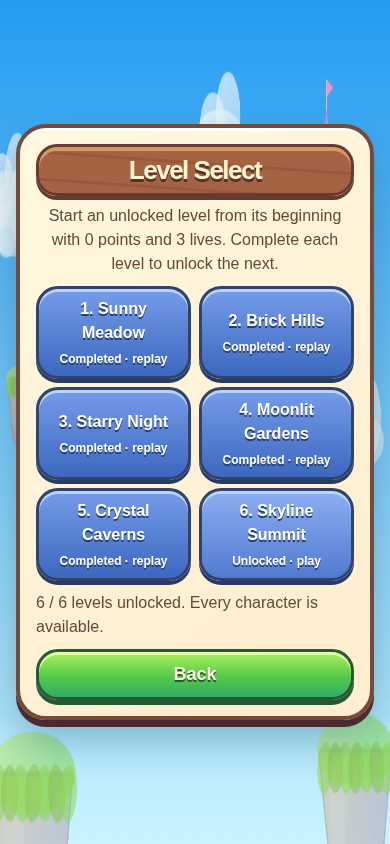

> **Stage H update:** attempt-local pennant retry terraces are now implemented under Issue #26. They retain used coins/enemy damage/points across death without farming, reset on level restart/transition and are not serialized. Continue/Level Select and all existing save formats remain as described below. See [Stage H rules and tests](stage-h-verification.md).

# Stage F — saved unlocks, Continue and Level Select

Implements [Issue #16](https://github.com/guardian6b-lgtm/coin-hopper/issues/16),
stacked on verified [Stage E / draft #21](https://github.com/guardian6b-lgtm/coin-hopper/pull/21)
at `3f41ed80c16826b20770c332704951422e5abfc0`. Branch `codex/progression`;
the draft PR records the final SHA, hosted results and temporary artifacts.
No merge, tag, deployment or release.

## Player-facing rules

- **Play = New Game.** Start at Sunny Meadow with 0 points, 3 lives and your
  selected hero. Earned level unlocks remain saved.
- **Continue** begins the saved attempt's level from its **beginning**, with
  **0 points and 3 lives**. It does not resume a mid-level position or banked score.
  Its associated text names that level and explains the fresh attempt. Continue
  is visible but disabled until a run has started.
- **Level Select** shows all six names, explicit Completed/Unlocked/Locked status
  and native disabled controls for locked levels. Complete each level to unlock
  the next; only contiguous completion unlocks later levels. Every hero is always
  available. A selected level also begins fresh at 0 points and 3 lives.
- Both Continue and Level Select enter **Choose Your Hopper → Start game**.
  Confirm saves the character/attempt. Back/Escape cancels without changing the
  saved attempt and returns to Title or Level Select as appropriate.
- Completing a flag saves completion and the next available level immediately,
  before pressing Next. Finishing the Guardian unlocks the final flag; reaching
  that flag completes Level 6 and Finish reaches the existing six-level victory.
  A replay of completed Level 6 still loads a fresh required Guardian and locked
  exit. All five heroes can complete the campaign without powers.

Native Tab/Shift+Tab, Enter/Space, mouse and touch work. Locked controls are visibly
disabled, carry explanatory text and are excluded from the focus trap. Continue's
description is associated with its button for assistive technology. Panels scroll
at small sizes so every button remains reachable; formal screen-reader/phone
acceptance remains separate.

## Persistence and isolation

The only new storage key is `coinhopper_progress_v1`:

```json
{"version":1,"completed":[true,true,false,false,false,false],"lastLevel":2,"started":true}
```

This example has Levels 1–2 complete, Level 3 unlocked and Continue at Starry Night.
The unlocked count is derived from the contiguous completed prefix; no untrusted
stored count can unlock later levels. Noncontiguous true entries are discarded.
Cursor values must be integers within unlocked levels; an invalid cursor safely
recovers to the first incomplete unlocked level. Wrong versions/shapes, malformed
JSON or oversized (>4096-character) payloads fall back to fresh progress.

Browsing Level Select or canceling the picker does not overwrite a save. Start/finish/advance writes only this
key; existing character, effects/music, global mute, reduced motion and best-score
keys retain their meanings. Storage failure is caught: progress still works within
the current session, but reload starts fresh if saving is unavailable.

No score, lives, inventory, HP, enemy positions, timer or mid-level position is
serialized. Reopening Continue or selecting a level cannot add a previous attempt's
points or preserve a partially defeated boss. Best score still uses the existing
maximum; it never sums separate attempts.

## Death, restart and checkpoints

| Action | Existing/new behavior |
| --- | --- |
| Ordinary death | Lose one life; respawn at the level's original start. Current run points/timer and earned damage/defeats/pickups remain. Shield and transient powers/attacks reset. Progress cursor/unlocks stay unchanged |
| Restart level | Keep remaining lives and prior levels' score; roll back current-level points. Reload fresh coins/enemies/boss/shield pickups and timer; clear powers/shield. Keep earned unlocks |
| Play/New Game or Try again | Fresh Level 1 attempt, 0 points / 3 lives. Keep earned unlocks, character/settings and best score; saved attempt cursor becomes Level 1 |
| Continue / selected level | Fresh chosen level, 0 points / 3 lives, new actors/pickups/full boss HP. Keep unlocks and preferences |
| Reload / app restart | Load validated unlocks and last attempt; open Title. The player explicitly chooses Continue or another run |
| Level completion | Save the completion/unlock once; metadata gives no points. Existing flag/defeat scoring stays authoritative |

**No new mid-level checkpoints are introduced.** Issue #16 makes them optional.
The recorded new-level routes are approximately 20 seconds for Crystal Caverns
and 29.47 seconds including the Summit boss; current deaths already retain HP
damage and used pickups/defeats. Keeping the original spawn model avoids inventing
checkpoint/farming behavior before human comfort testing. Original Levels 1–4
remain checkpoint-free; any later checkpoint proposal needs explicit semantics and
separate evidence. Current death, restart and duplicate-boss-award tests remain.

## Verification

Local verification October 26, 2026 (America/New_York); final exact-head hosted
results are in the draft PR.

| Check | Result | Evidence / scope |
| --- | --- | --- |
| Full Node suite | PASS locally | **308 tests**: previous 268 retained plus 40 progression cases; all five heroes × six selected-level starts |
| Original simulation/maps | PASS | Six definitions, balance tables and authoritative functions stay hash-locked; all 30 legal no-power/no-shield routes retain 3510 points and three lives |
| Earned progression | PASS | Each of five full campaign recordings now asserts sequential unlocks and all six completed flags; first-level browser route actually earns its unlock without world edits |
| Save validation / fallback | PASS | Bad versions/shapes/cursors, noncontiguous completion, oversized payload, blocked storage, existing-save isolation and cancel-without-write |
| Reset / anti-farming | PASS | Fresh score/lives, death and restart, saved completed boss still requires a new fight, no repeated flag/metadata award |
| Full Chromium | PASS locally | **94 groups**, zero page errors; previous 88 plus six progression groups, actual route/reload, five sizes, all heroes/boss gate, pointer/keyboard and simulated portrait touch |
| Responsive selection | PASS locally | 960×540, 1440×810, 390×844, 844×390 and 320×240; all six native choices remain 44px+; the six choices and Back fit standard desktop sizes, while smaller panels scroll |
| Actual offline Linux Electron | See PR | Full audio/controls/enemy/route smoke plus earned unlock, Continue, reload, all five heroes and responsive Level Select |
| Windows NSIS/portable | See PR | Exact-head workflow, earned unlocks across full process restart, real offline storage/menu flows, actual content-window sizes and existing audio/minimize/F11/resize checks |
| Human UX, physical touch, audible audio, formal screen-reader/art/balance acceptance | NOT TESTED | Injected browser/Windows controls and signal measurements do not establish human/device acceptance |

Late-game availability/locked-exit screenshots use clearly labeled seeded-save and
position fixtures; they do not claim that a human earned those completions. Separate
canonical recordings cover all six legal routes and the required five-hit boss.

Screenshot review found Back below the fold at 960×540; the Level Select layout was tightened and an explicit full-panel assertion now guards standard desktop sizes.

No confirmed unresolved defect remains in completed local checks. Optional checkpoint
comfort remains a human playtest question. The next separate stage is Issue #14's
full release-verification record; no public release is authorized.






