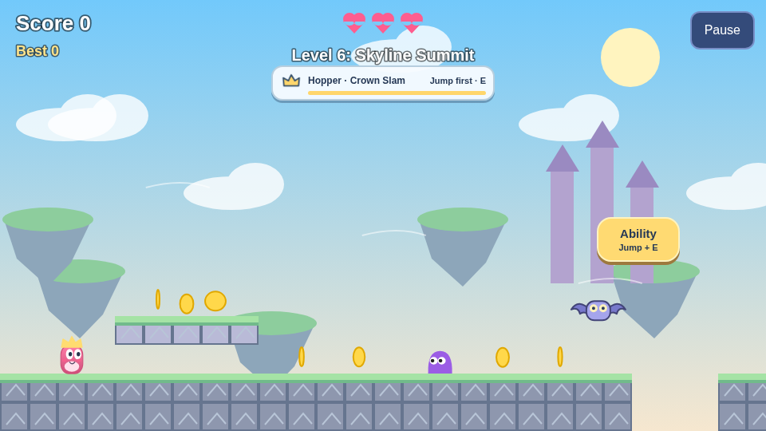
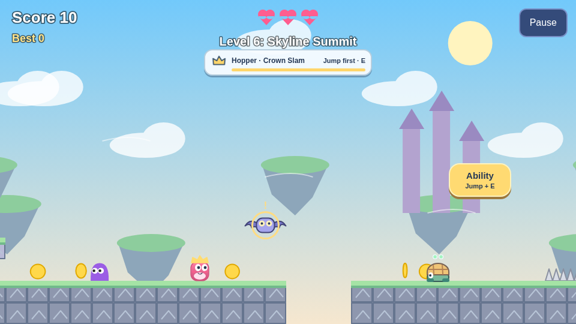
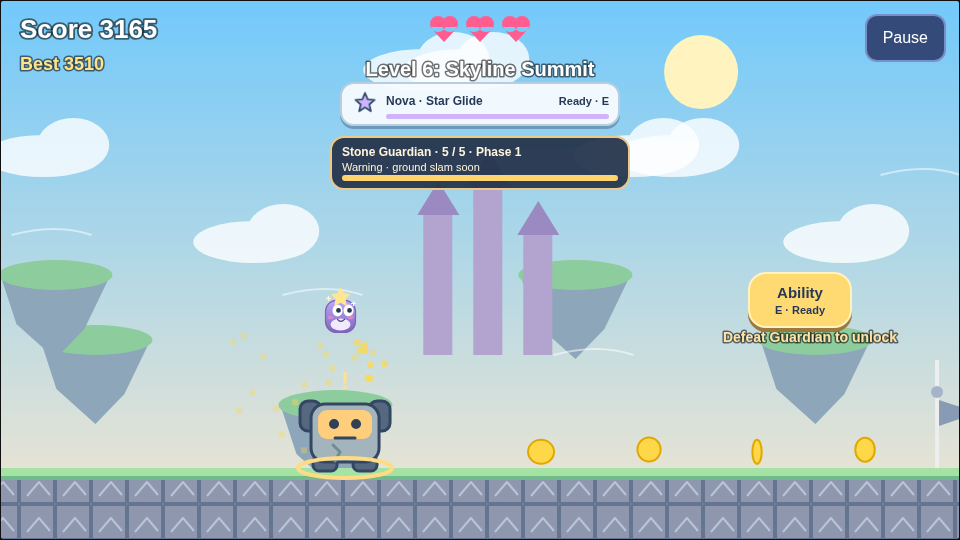
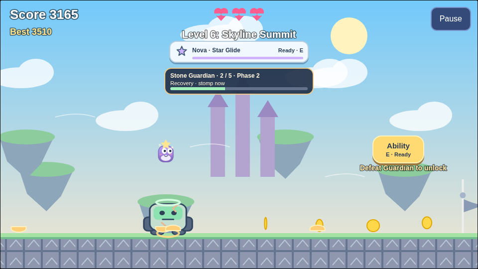
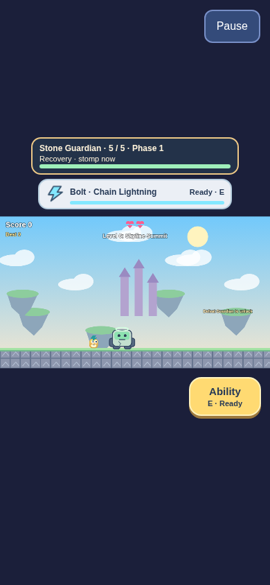

# Stage C — Skyline Summit, Nightwing and Stone Guardian

Implements [Issue #12](https://github.com/guardian6b-lgtm/coin-hopper/issues/12),
following approved [Issue #6](https://github.com/guardian6b-lgtm/coin-hopper/issues/6).
Branch `codex/skyline-summit` starts from verified Stage B / draft PR #18 at
**`9375812bcf767162acbf6a0ccfb0c9f179eb430a`** (211 Node tests, 64 browser groups and
Windows NSIS/portable checks passed). The draft PR targets `codex/crystal-caverns`.
Exact Stage C SHA and hosted artifact links are recorded in its PR. Nothing merged,
tagged, deployed or released; main and parent branches stay untouched.

## Six-level progression

Skyline Summit is a new 152-column map: clouds, distant castle, floating islands,
visual-only wind streaks, higher landings, familiar ground enemies and three
Nightwings. Four gaps connect safe islands; two cover blocks protect approaches to
Sentinels. An optional shield is on a raised platform before the final arena.
The arena has continuous flat floor and room to approach, retreat, jump and dodge;
there are no compulsory arena pits. Background ornaments never affect collisions.
System reduced motion removes decorative wind streaks and wing-flap/squash accents;
enemy movement and essential attack warnings stay deterministic and readable.

The Stone Guardian is mandatory. Its flag is visibly locked and touching it gives
no finish or bonus until the boss is defeated. `bossState.defeated` survives corpse
cleanup and player death, preventing a relock or repeated boss award. Restart/new
run reloads a fresh required fight and applies the existing level-score rollback.
Finish now leads to the explicit **All 6 levels complete** Win screen.

The five earlier complete level definitions, geometry and recordings are unchanged.
Original running/jumping/hitbox/coins/shields and scoring conventions stay intact.
New enemy behavior is dispatched separately; the old types and ability parameters
retain their values. Full reference-driven art, music and progression saves remain
separate later stages; these screenshots show functional Stage C artwork.

## New enemies and provisional values

| Mechanic | Initial implementation |
| --- | --- |
| Nightwing | 1 HP, +50 once; 30×24 body; 48px horizontal / 12px vertical patrol, period 3.2s |
| Dive | First-ready delay 1.4s, acquisition within 180px and terrain LOS, 0.65s visible charge with locked aim, up to 0.7s at 190px/s, safe return at 110px/s and 1.8s recovery |
| Flight collision | Every movement uses solid collision with a capped step; blocked returns re-anchor at the current safe perch rather than teleport through terrain. Offscreen attacks cancel; roots freeze/resume timers |
| Stone Guardian | 5 HP, +50 once, 68×64 body. Shared player remains exactly 26×32; normal held jump reaches its stomp surface |
| First phase | 1.2s first-ready delay; 1s guarded wind-up, two outward ground shockwaves, up to 1.6s recovery, 0.9s rest |
| Second phase | At 2 HP, visible cracks and Phase 2 HUD; 0.75s wind-up, 1.3s recovery and 0.65s rest. Same clearly warned slam pattern, no hidden extra attack |
| Shockwaves | 150px/s, radius 7px, lifetime 2.4s; terrain/player sweep collision, finite global shot count, offscreen and owner-death cleanup |
| Vulnerability | One HP per recovery opening. Stomp/Slam/Fireball/Lightning use the shared damage API; armor visibly closes after an accepted hit. Guarded stomps retain the normal safe bounce without damage or score |

All parameters are centralized in `ENEMY_TYPES` / shared combat tables. No partial-hit
score. Minty snares the Guardian for the existing 2s while its 4s cooldown prevents
permanent rooting; phase timers resume after release. Root does not stop already
released waves. Nova retains normal ascent, falling cap, steering and stomp rules;
she can jump/glide over waves without flight or pit immunity. Other attacks remove
one HP only during the visible opening, so no single cast skips the encounter.

Pause, Settings, Controls, restart confirmation and blur freeze phases, HP, roots,
projectiles and FX. Death clears transient combat, resets live attack timing and
preserves earned HP damage/defeats, just as Stage A defines. Used coins/shields stay
used after death. Restart restores actors and the boss gate while rolling back only
that level's points. Defeating the boss clears its waves, grants +50 once and opens
the exit; the usual flag formula is awarded only when the unlocked flag is reached.

## Recorded no-power victory

`tests/fixtures/skyline-summit.cjs` records actual Space and left/right key transitions,
including stopping above the boss for repeated universal stomps, then approaching
the unlocked flag. No actor/world edits, invulnerability changes, powers or shield
pickups occur during the route. All five heroes reproduce the same result:

- **1768 frames / 29.47s**, three lives, 765 points: 31 coins (+310), four defeats
  including the Guardian (+200), final flag (+255).
- Boss HP falls at frames **1121 → 4, 1266 → 3, 1412 → 2, 1521 → 1, 1630 → 0**.
  Guarded bounces give no HP damage or points; each valid hit uses a new opening.
- The complete five-character × six-level matrix finishes at **3510 points**,
  preserving original checkpoints 500/1045/1590/2190 and Level 5 total 2745.

This proves a legal no-power path and does not certify human difficulty. Human
playtests should review whether camping above the boss is too easy, warning/weak-point
clarity, dive timing, wave speed and phase cadence. Tune only with evidence; do not
change original physics/maps. A pre-arena checkpoint can be considered in Stage F
with explicit anti-farming semantics; none is introduced here.

## PASS / FAIL / NOT TESTED

Local verification October 26, 2026 (America/New_York). Final hosted results are in
the draft PR after execution.

| Check | Result | Evidence / scope |
| --- | --- | --- |
| Full Node suite | PASS | **241 tests**, no failures/skips; 211 foundation cases retained and 30 Summit/boss cases. All five heroes replay full six-level runs plus explicit five-hit boss recordings |
| Original Levels 1–5 | PASS | Full definitions equal verified Stage B; all prior legal recordings/outcomes unchanged. Original first-four definition hashes remain locked |
| Full Chromium | PASS | **79 groups**, no page errors: all 30 hero/level routes, real HUD, power interactions, Nightwing charge/dive, locked exit, shield/pause/death/restart, reduced motion and five viewport sizes |
| Boss/flight safety | PASS | Guard/opening/phase timing, single awards, no gate bypass, swept waves, collision-capped flight, root expiry, owner cleanup and persistent defeat state |
| Browser screenshots | PASS | Real intro, flyer wind-up/dive, actual no-power boss route at 5 HP and phase two, all five power fixtures, responsive HP HUD. Fixture images are identified separately from legal-route captures |
| Linux Electron | PASS | Actual offline packaged app, both new levels replayed by all five heroes, native menus/powers/enemies, saved settings/character. Route replay suspends RAF only for deterministic fixed-step input; native controls/window tests remain separate |
| Windows Node 22 / x64 NSIS and portable | NOT TESTED locally | Existing artifact-only workflow enabled for this branch; actual independent executable checks include every hero's Level 5/6 routes and required boss victory. Final outcomes/SHA are in the PR |
| Native F11/resize | NOT TESTED locally | Linux headless run labels these NOT TESTED. Windows CI uses actual window APIs/key injection, not a physical keyboard |
| Human balance, real phones, audible playback, formal accessibility/art acceptance | NOT TESTED | Human/device checks remain open. Music remains NOT IMPLEMENTED until Stage E; full art-reference match belongs to Stage D |

No confirmed unresolved defect from completed checks. After green hosted gates,
next development stage is Issue #13's separate visual redesign using the approved
image. This stage does not substitute technical automation for human acceptance.

## Artifacts and reproduction

```sh
node --test
node scripts/verify-browser.cjs # isolated Playwright 1.62 + Chromium required
node scripts/verify-executable.cjs --executable /path/to/coin-hopper --label local --output /tmp/summit-smoke
```

**skyline-summit-browser-evidence** contains the self-contained six-level HTML,
screenshots and JSON reports; `enemy-arena.html` remains a separate test utility.
**coin-hopper-windows-x64-verification** contains temporary NSIS/portable executables,
checksums and independent smoke evidence. Seven-day retention, --publish never,
unchanged product packaging dependencies/permissions and release workflow.










