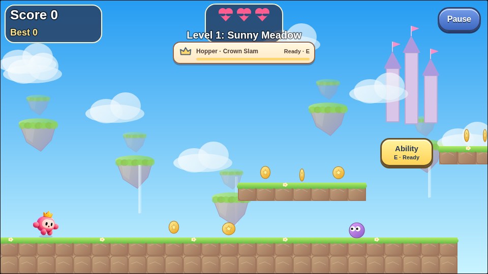
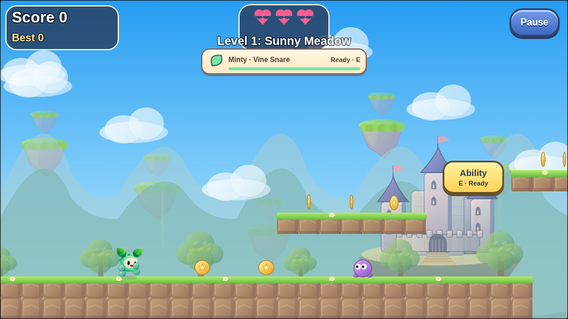
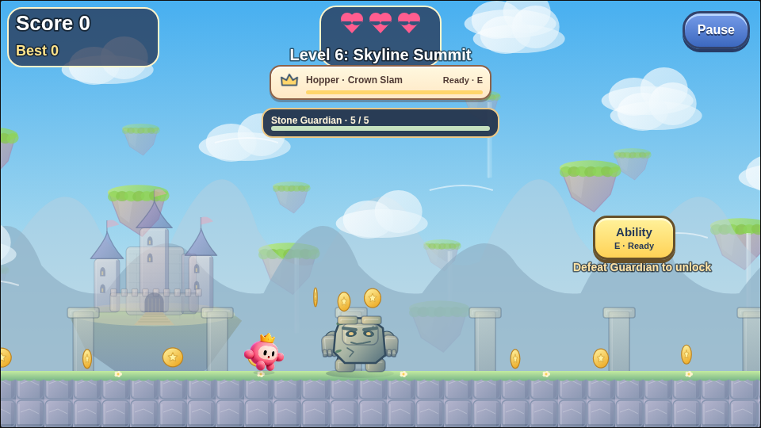
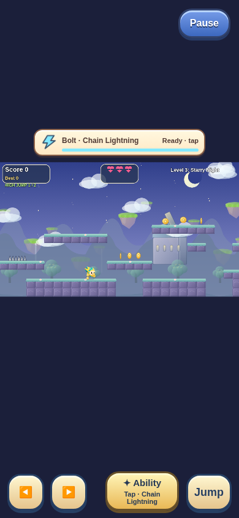

# Stage H technical verification and owner handoff

Scope: [master Issue #26](https://github.com/guardian6b-lgtm/coin-hopper/issues/26), #24/#25, existing **draft [PR #27](https://github.com/guardian6b-lgtm/coin-hopper/pull/27)** on `codex/stage-h-integrated`, stacked on Stage G `3469a3d78d429faf6385cb85bdecfcc459d1a2b8`. See the PR body for exact final head, hosted workflow results and expiring downloadable artifacts. Stage G/main/reference branches are not modified or merged. This is preparation for coordinated owner acceptance, not release approval.

## Implemented and preserved

- Two-charge High Jump boots for every hero; separate successful grounded jumps, same strength, no double-jump, no extra button. Charge display includes2→1→0. Death/restart resets protection and restores zero-point boots; abilities remain independent.
- Starry Night's reported row is shortened **only from108 px to72 px** at original columns27–29, and boots are placed on the safe lower approach. The full legal route remains possible without collecting boots; a boosted lower approach offers broader input tolerance.
- Eight contact/passing/flight run frames for all heroes, selected by distance; independent limbs, mirrored facing, atlas identity, existing six poses/landing/hurt/victory and reduced motion. Pause freezes visual clocks. Actual-size input footage and eight-frame strips are separate from enlarged art diagnostics.
- All six levels add96 columns (3456 px) with three platform/reward/encounter/crossing beats and safe attempt-local retry terraces. Original maps invert exactly after removing extensions except the explicitly approved Level3 boots/spike correction. Summit's original arena shifts96 tiles right. No duplicate boss/flag.
- Connected castle and terrain foundation, mountains/trees/aqueduct/observatory/garden pavilion/crystal galleries/summit ruins, tile bevels/occlusion, dimensional heroes/enemies, articulated foot/wing motion, illustrated shield/boots and hero VFX. [Art provenance](art/stage-h-art.md) distinguishes original Canvas work from the unchanged original reference and atlas.
- Guardian's existing68×64 collision rectangle and5 HP remain. Jointed stone/moss/plate/weak-seam art; phases at5–4 /3–2 /1 HP; windups1.15/1/.9s, recovery1.8/1.8/1.6s; ground stone waves, arcing boulders and marked debris. Attacks use deterministic60Hz timing and terrain collision; one accepted HP per opening, one-time+50 defeat. Config is centralized in `GUARDIAN_ENCOUNTER` alongside original enemy configuration. Native health/name/defeat remain; AI state, next move, commands and countdowns are absent in normal HUD/canvas/accessibility text. Source-only developer flag isOFF.
- Native60 px touch movement/jump buttons, separate Ability with icon/name/Tap feedback, visible Pause, pointer ownership/cancel/blur/rotation. CSS-pixel targets stay44 px+ at five phone/low-height sizes; canvas stays above the action controls. E/keyboard/mouse/native menus remain.
- Ordinary acceleration/speed/gravity/jump-release/hitboxes and base scoring rules are unchanged. Existing abilities, enemies, shields, music/effects/mute, best/character/settings/unlock storage and offline Electron security configuration remain. Continue/Level Select start a fresh attempt, not a saved inventory or score. Session checkpoints retain used coins/enemy HP/earned points without regenerating rewards; Restart rolls back level points and restores full content.

## Candidate evidence (local scope; hosted exact head is in PR #27)

Local environment: Debian 13, Node 24.19.0, actual Chromium 154 and Electron 44.7.2 packaged application. No physical phone or Windows machine is attached locally. The Windows and WebKit workflows are supplied and must be read at the exact PR head before interpreting their result.

| Check | Local result | Evidence / scope |
|---|---|---|
| Pre-edit Stage G baseline | PASS |308/308 Node tests before source edits; parent independently verified live |
| Full current Node regression | PASS |337 tests, zero skipped/failures;308 prior cases retained/adapted explicitly for authorized maps, route scores and hidden debug HUD |
| All5 heroes×6levels | PASS |30 legal normal-menu campaign recordings,3 lives, no character power or shield; optional boots collected in five level routes; Level3 route needs none |
| Original content / physics | PASS |Archived original map hashes retained; extension inversion test permits only documented Level3 local changes; collision/ability/nonboss AI locks and movement/arc tests retained |
| High Jump / Level3 | PASS |2 equal launches; normal108.5 px vs boosted193.6667 px maximum rise; grounded-only charge consumption; independent shields/powers; pause/reset/transition; lower crossing at x24/24.5/25 tiles ×18/24/30/36/42/48-frame holds for all heroes |
| Existing Chromium checks | PASS except local file URL |94 passing groups, zero page errors; one file-access check is locally NOT TESTED due environment denial; actual Electron file play is separately verified |
| Added Stage H Chromium | PASS |14 groups: all-hero boosted crossing,5sizes/target separation/Pause, five real CDP three-contact casts plus a fourth canvas contact, cancellation, hidden boss narration,40distinct native-scale run frames, pause/offline/rotation |
| Native before/after and normal-input evidence | PASS |Exact Stage G comparison,960×540/1440×810/390×844/844×390/960×360; all 6spawn scenes and boss; all-hero ordinary-spawn wall-clock keyboard clips/frame sequences. Fixtures are named. Owner quality approval is separate |
| Render budget | PASS on this runner |360 six-scene draw sample;p95 threshold33.34ms; actual measured JSON in artifact includes mean/max/outliers. Not a phone FPS/heat/power certificate |
| Offline packaged Linux app | PASS |Actual Electron file renderer,30routes,all powers/enemies/shields/audio/progression/fullprocess save restart,5boots crossings and boss privacy. Embedded HTML matches source byte-for-byte |
| Windows NSIS/portable build and executable smoke | PASS hosted / NOT TESTED locally |Dedicated Windows CI builds without publishing; tests both actual executables, all 30routes, High Jump, privacy, persistence/F11/resize/minimize/restore. Final exact-head outcome is in PR27 and bundled JSON; do not infer it from Linux |
| WebKit mobile emulation | NOT TESTED locally |Local WebKit download host denied access; hosted Ubuntu workflow installs WebKit and runs same14 groups. Pointer injection there is not physical multi-touch Safari |
| Audio | PASS technically / human NOT TESTED |Existing independent buses/mute/offline/loop/signal/mixing tests retained; no new music assets. No human listening or physical hardware claim |
| Real Android/iOS, human Windows, art/balance/accessibility | NOT TESTED |Owner checklist below; automation is not acceptance |

Old route recordings remain in `tests/fixtures/routes.cjs`, `crystal-caverns.cjs`, `skyline-summit.cjs` and the explicit Stage G campaign aggregator. New inputs live in `stage-h-routes.json` plus the optional cave bonus route. The new cave bonus reaches every original raised group without losing its shield. No assertion was simply deleted to conceal an unreachable route. Fixed60Hz replays batch drawing between input changes; native-input footage/render budget use real rendering separately. Route generation used speculative search, but final fixtures replay only real key handlers and simulation, without actor edits, removed enemies, invulnerability changes or collision bypasses.

The first integrated candidate `d74cf5351bf462cab9718cc5c20215be85269289` passed Node22 Ubuntu/Windows,95retained Chromium groups,14Stage H Chromium groups and14WebKit groups in [run40510875231](https://github.com/guardian6b-lgtm/coin-hopper/actions/runs/40510875231), plus both actual Windows executable suites in the linked Windows run. Final refinements add native fixture animation sequences, transition/reload coverage, correctly linked bundle documentation, canonical Windows HTML bytes, and a reproduced mixed-input fix: canvas touches and native button contacts retain independent ownership instead of clearing each other. Final local suite337/337; final-head compatibility/artifact links are in PR27. Final product HTML SHA-256: `8f3c96f48576b0924362dff6dafd43eaec27b740bd2a205df59e04ae54db71da`. Art, maps, ordinary simulation and scoring did not change during these integration fixes.

## Measured route comparison

Authored widths omit the extra padded boundary column. [Raw measurement data](stage-h-route-measurements.json) compares the exact Stage G source against current source.

| Level | Stage G columns →Stage H | Baseline replay s →new replay s | New route points |
|---|---:|---:|---:|
| Sunny Meadow |77→173|10.02→23.30|625|
| Brick Hills |83→179|11.90→25.18|615|
| Starry Night |85→181|11.35→24.73|580|
| Moonlit Gardens |108→204|14.12→27.40|665|
| Crystal Caverns |148→244|19.78→33.45|585|
| Skyline Summit |152→248|29.47→41.68|745|

Total canonical score**3815**, identical for every hero; each survives with3 lives. Coin+10, defeat+50 and the existing time-based flag bonus are unchanged; extra content and elapsed time justify changed totals. Final boss HP hits occur at frames1928/2051/2166/2265/2358; this route cannot bypass its required fight. These are deterministic durations, **not expected human traversal times**. Proposed human pacing targets in the development record are unvalidated; level length/variety and boss difficulty require owner judgment. New sections deliberately share a teach/practise/reward motif; report repetitive or empty stretches during the integrated review.

## Review and reproduce

```sh
node --test
node scripts/verify-browser.cjs
node scripts/verify-stage-h.cjs
STAGE_H_WEBKIT=1 node scripts/verify-stage-h.cjs
node scripts/capture-stage-h.cjs
```

Browser scripts need Playwright 1.62 and matching installed engines/FFmpeg. Linux packaging can use the existing installed Electron distribution when the default cache path is read-only. Product configuration is unchanged. Windows workflow uses locked desktop dependencies, `electron-builder --win nsis portable --x64 --publish never`, compares copied HTML and canonical Git-object bytes (LF pinned with `.gitattributes`), then tests actual NSIS-installed and portable EXEs in isolated CI profiles. It uploads one integrated test bundle with the sameHTML, Windows binaries, checksums, local phone-serving helper, instructions and screenshots; no APK/IPA or release is generated. Browser evidence contains full before/after sequences, video and JSON. Downloads expire after7 days.

## Native evidence samples







[All-hero native-scale articulated strips](screenshots/stage-h/native-scale-run-strips.html) are isolated renderer diagnostics; the video and `native-run-*` PNGs are ordinary input samples. Artifact notes state how captures were produced. `stage-h-animation-sequences.html` and its JSON enumerate native960×540 controlled sequences for all five power casts, pickup/active states, enemy locomotion/reaction/defeat, Guardian stone patterns/defeat, and all-hero hurt/victory; these are explicitly fixtures, not ordinary playthroughs. Formal art-reference fidelity remains owner-reviewed; no claim of pixel-exact painted art or physical phone rendering.

## Remaining acceptance / next action

No confirmed gameplay blocker remains in the completed local checks. Hosted compatibility remains a technical gate until its exact-head checks pass. Then conduct **one integrated owner playtest** using [START HERE](stage-h-playtest.md), recording tester/date/build/device/OS/browser/audio hardware and PASS/FAIL/NOT TESTED per check.

Human gaps: actual Android/iPhone/iPad contacts/notches/browser chrome/rotation/long sessions/heat; Windows consumer installation/uninstallation/shortcuts/security/DPI/physicalF11; audible speakers/headphones/Bluetooth/mute/mixing; native-size art/readability, screen-reader/keyboard accessibility, motion sensitivity, level length/variety, Level3 touch fairness and three-phase boss balance with/without each power. Downloaded Windows ZIP/checksums/pixels need independent owner inspection; CI execution is not that human inspection.

Retain draft status. Do not merge any PR, change main, tag, deploy or release. An optional private HTTPS preview is only a proposal requiring separate explicit approval, not part of this execution.
