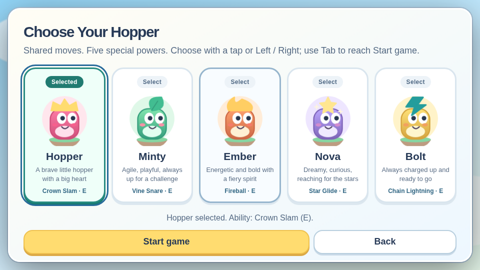
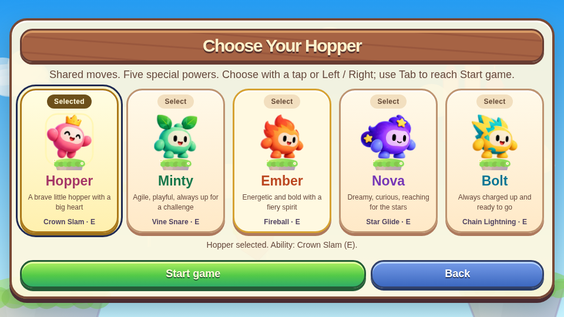
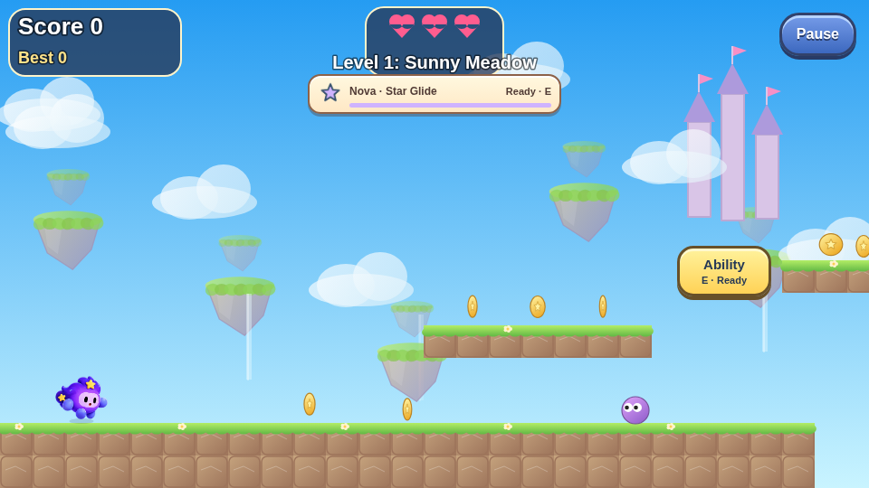
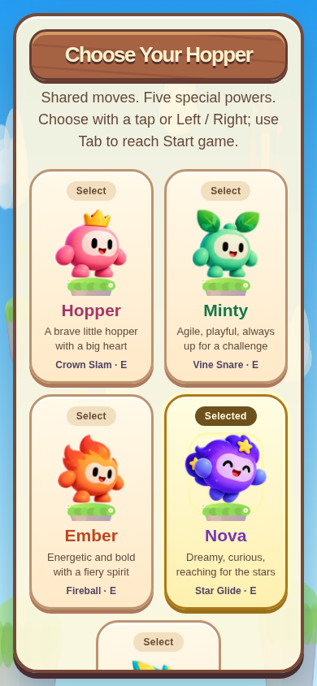

# Stage D — official-reference visual redesign

Implements [Issue #13](https://github.com/guardian6b-lgtm/coin-hopper/issues/13),
stacked on verified [Stage C / draft #19](https://github.com/guardian6b-lgtm/coin-hopper/pull/19),
parent `6381c6f81a169bfbc702591fc2ead0ef81eca765`. Development branch:
`codex/visual-redesign`. Exact final SHA and hosted results are recorded in its
draft PR. Nothing is merged, released, tagged or deployed.

## Reference and runtime artwork

The [exact approved original PNG](art/reference/coin_hopper_character_selection.png)
was downloaded from the owner-supplied pinned raw URL and copied byte-for-byte:
1672 × 941 RGB, 1,954,012 bytes, SHA-256
`6d4e5d7ebbab523c159983df725c1c9efd4c67a7988a284ec358608bee3d9f4d`.
PNG signature, every chunk CRC, end boundary and full image decoding passed.
[Provenance](art/reference/README.md) records the original asset commit and URL.
The isolated `codex/approved-art-reference` branch was **not merged**.

The runtime mascots were generated using the actual inspected reference, then
visually inspected and integrated as a transparent 30-frame atlas. This generated
artwork is **separate** from the unchanged original reference:
[PNG](art/generated/characters-v1.png) / [frame manifest](art/generated/characters-v1.json).
The manifest records its SHA-256, dimensions, identities, poses and individual
frame rectangles. Frames use individual bounds rather than assuming perfectly
uniform generated grid spacing. No image transformations are applied to the
archived original or generated source bytes.

All five retain the approved identities: pink crowned Hopper, two-leaf Minty,
flame-haired Ember, purple star-haired Nova and yellow/teal lightning Bolt. Cream
face masks, black oval eyes, round hands/feet and soft toy-like shading follow the
reference. Each has **idle, run, jump, fall, hurt and victory** artwork. Render-only
bobbing adds movement to idle/run/victory; facing mirrors artwork. The original
26×32 player rectangle and squash simulation never change. A vector fallback
keeps all identities/poses usable if image decoding is unavailable.

The PNG is embedded as a local data URL in `index.html`, preserving the existing
single-file browser and Electron configuration. No CDN, fonts, network permission,
runtime asset loading or new game dependency. The page is approximately 2.31 MB;
the atlas is about 1.6 MB. One decoded atlas is reused for portraits and gameplay.
Rebuild or verify the payload with:

```sh
node scripts/embed-character-art.cjs
node scripts/embed-character-art.cjs --check
```

## Live interface and world interpretation

- Native, keyboard-focusable buttons remain the actual menu controls. The picker
  uses five grassy pedestals, cream plaques, explicit Selected status, a wooden
  heading, green Start and blue Back. All menus share the rounded panel/button
  treatment; there is no flattened menu screenshot overlaid with invisible hotspots.
- A decorative canvas supplies cloudy floating islands, waterfalls and a distant
  castle behind the menu. It is hidden from accessibility APIs and accepts no input.
- Six scene palettes provide sunny meadow, warm hills, starry sky, moonlit garden,
  layered crystal cave and high summit scenery. Parallax, grass, flowers, beveled
  local tiles, stars on gold coins, shaded enemy bodies/armor/crystals, impact dots,
  shield bubble, score/lives panels and the existing boss/ability HUD are coherent.
- Collision edges, spikes, pits and enemy warnings remain readable. Decorations
  do not add platforms or hide a collision surface. All six complete level
  definitions and authoritative movement/combat functions are hash-locked to Stage C.
  Source hashing normalizes CRLF/LF so Windows checkout line endings do not create
  false differences; an initial Windows test-only failure was reproduced and fixed.
- **Reduce decorative motion** in Settings stores `coinhopper_motion_v1` separately
  from character and volume preferences. System reduced motion also applies.
  It removes player bobbing/flashing/squash, decorative wing/body pulse, wind,
  coin/shield/flag motion and softens particles. Essential enemy movement,
  telegraphs, projectile motion and damage indication remain. The hurt pose replaces
  flicker; invulnerability, physics and timing remain unchanged. Blocked storage is safe.

This is an interactive interpretation of the approved design, not a pixel-exact
reproduction. Formal owner/human visual acceptance remains open. Backgrounds and
tiles use local vector art; the reference's detailed painted landscape is translated
into lighter Canvas2D scenery rather than embedded as a full-screen mockup.

## Verification

Local verification October 26, 2026 (America/New_York). Final hosted outcomes apply
only to the exact SHA linked in the draft PR.

| Check | Result | Scope |
| --- | --- | --- |
| Original reference bytes | PASS | Published SHA-256, PNG structure/CRCs and image decoding match |
| Full Node suite | PASS | **251 tests**; previous 241 cases retained, focus-order case includes the new checkbox |
| Simulation/geometry lock | PASS | Six full definitions, ability/enemy tables and authoritative movement/damage/AI functions match the verified parent |
| Full Chromium | PASS | **84 groups**, zero page errors; all 30 no-power routes, keyboard/touch simulation, menus, lifecycles, shields, boss and powers |
| Character pixels | PASS | All 30 hero/pose frames distinct in an actual renderer; atlas decoding succeeds |
| Before/after browser captures | PASS | Verified Stage C source vs current page; 960×540, 1440×810, 960×360, 390×844, 844×390, six scene fixtures and seven menu fixtures |
| Responsive controls | PASS | Every hero, Start and Back scrolls fully into view and remains at least 44×44; the 320×240 oversized-card defect found during development was fixed |
| Reduced motion/persistence | PASS | Native checkbox, reload, system preference, blocked storage, stable player pixels and unchanged simulation |
| Render timing | PASS on local runner | 360 six-scene draws: mean 3.43 ms, p95 1.20 ms, maximum 114.60 ms. Startup/GC outliers are included; this does not certify phone frame rates or universal 60 FPS |
| Linux packaged offline app | See PR | Actual file-based app smoke and capture reports; no network assets |
| Windows NSIS/portable and actual before/after captures | See PR | Workflow builds verified parent locally for before captures and current actual app for after captures; five native content-window sizes, offline smoke, saved preferences, F11 and resize |
| Formal owner art acceptance / readability in motion | NOT TESTED | Compare reference and real captures; review silhouette, terrain readability, ornaments, warnings and hurt/victory feedback |
| Real phones/tablets, physical input, audible playback, screen reader | NOT TESTED | Browser touch and Windows input are injected automation, not hardware/human acceptance |

The atlas and UI were visually inspected in real local browser captures. Gameplay
fixtures position scenes only for screenshots; the separate recorded routes use
legal keyboard transitions and no power, shield, invulnerability or world edits.
Windows captures are actual packaged renderers, not browser screenshots relabeled
as Windows; independent human inspection remains a separate gate. Temporary CI
artifacts expire after seven days. No public executable release is created.

## Before / after









The artifact contains all 56 comparison captures and the standalone before/current
pages. Historical roadmap information from draft PR #7 remains in README; that PR
is still separate and unmerged. Next stages are original music (#15), progression
(#16) and final six-level verification (#14), gated on this stage's technical checks.
